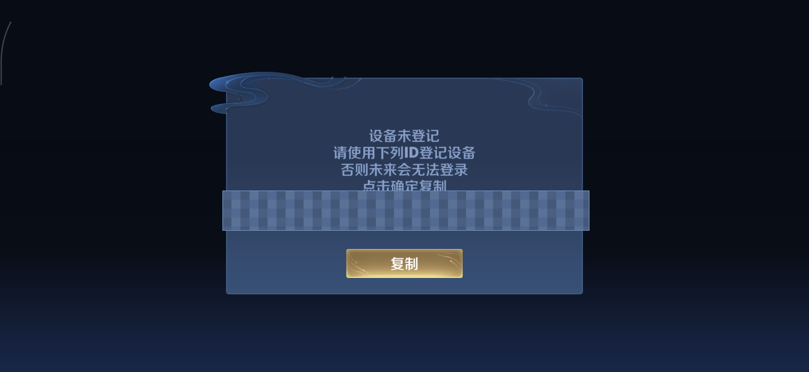
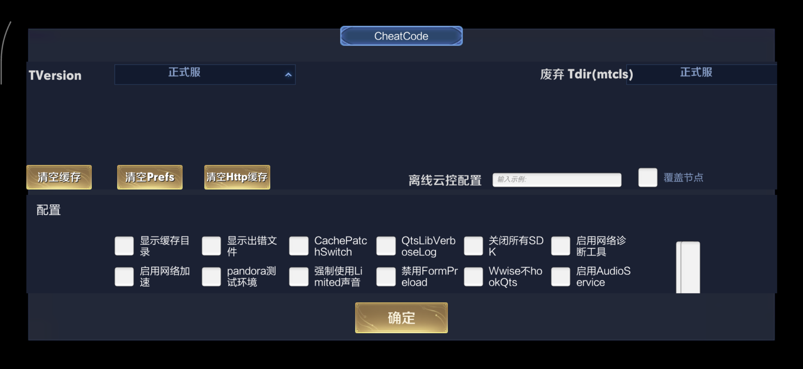
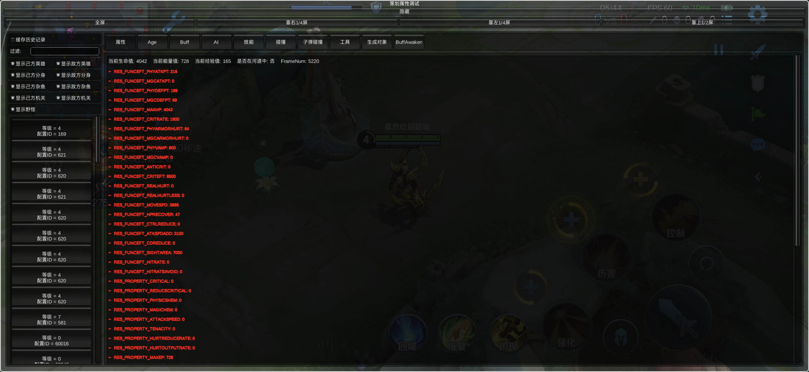
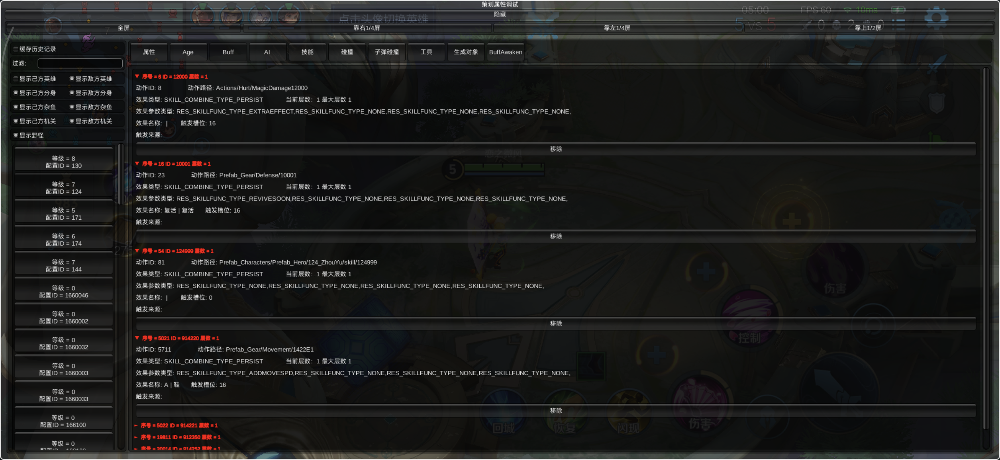

> **声明：本文只记录个人设备和本地安装包上的分析结果，内容由 AI 生成。**
>
> 2026-06-17 更新：训练营中已能通过 `CheatCommandBattleEntry._GMDesignDebugCommand` 唤起「策划属性调试」面板。

## 前言

以前在网上偶尔能刷到一些王者荣耀早期版本或者体验服的内部调试截图，画面里带着各种环境开关和局内属性修改按钮。最近闲下来，我拿手头的 root 测试机装了一份王者荣耀 Android 正式服 `11.3.1.1` 的本地安装包，顺着 Java 层事件和 IL2CPP 元数据翻了一遍，想看看当前正式服的安装包里到底还留着多少调试面板代码，以及在本地环境下能不能把它们真正调出来。

几轮静态与动态排查做下来，我从当前安装包里梳理出了三条相互独立的调试面板分支。第一条是挂在启动阶段的 `CheatCode` 外层环境配置面板，靠隐藏触摸暗码配合一处内存分支修改就能打开；第二条是对局内的「策划属性调试」面板，需要先在选服页拦下腾讯 TerSafe（TP）的检测线程，再通过原生探针调用 `CheatCommandBattleEntry._GMDesignDebugCommand` 唤起；第三条则是早期网传截图里常见的 `GM指令`、`DldGMPanel` 和 `OpenGM` 资源，这批资源块在正式服里依然完整保留，而且跟体验服字节级一致，只是大厅里的直接打开入口还没找到。下面按排查顺序把这两套已跑通面板的触发机制和验证过程记一下。

## 外层 CheatCode 配置面板的触发与绕过

先看最外层的 `CheatCode` 配置面板。翻看客户端 Java 层的触摸事件处理器可以发现，游戏在刚启动播放开场视频和弹出启动对话框的阶段，埋了一段针对屏幕四角与中心区域的隐藏触摸暗码检测逻辑。只要在这个阶段按顺序依次点击屏幕的特定区域，就能命中暗码校验。

```text
左上 -> 右上 -> 右上 -> 右下 -> 左下 -> 中心
```

Java 层识别到这串点击序列后，会把内部的调试显示开关置为 `true`，随后把控制流转进 Unity 与 IL2CPP 层的 `IsEnableGM()` 和 `OpenCheatForm()` 等方法。不过在未修改的客户端上，哪怕手法完全正确地敲完这串暗码，面板也不会直接弹出来，屏幕上只会跳出一个「设备未登记」的拦截弹窗。



```text
设备未登记
请使用下列ID登记设备
否则未来会无法登录
点击确定复制
```

顺着这个弹窗的文本往回找，可以看到背后挂着一个 IL2CPP 侧的异步状态机。暗码触发后，状态机会先向内部服务端发一条 HTTP 请求，校验当前设备的硬件 ID 是否在内部研发白名单里。外部测试设备自然过不了这层网络校验，状态机随后就会走到失败分支并弹出上面那个警告框。

既然拦截逻辑只是一处本地状态机的条件分支跳转，绕过思路就很直接了。在游戏进程启动之后、手动输入触摸暗码之前，直接利用 root 权限修改当前进程的内存指令，把设备登记状态机里的这处条件分支改成 `nop`。这样暗码再次命中后，执行流就会直接落进校验通过侧的清理路径，顺理成章地把 `CheatCode` 面板渲染出来。需要注意的是，这种运行时内存修补只对当前的进程 PID 生效，每次重启游戏后都需要针对新 PID 重新写入一次。

在实机验证时，一边盯着日志一边按顺序点击屏幕四角与中心，可以看到控制台依次打印出 `0` 到 `4` 的触摸区域序列号，紧接着 `m_bOpenCheat` 与 `java IsShowCheatWindow` 两个标志位同时变为 `true`。核对修补前后的进程 PID 完全一致，屏幕上方也随之弹出了完整的 `CheatCode` 调试面板。



从界面上的按钮布局能看出来，这个外层面板主要服务于客户端基础设施与运行环境调试。里面包含了版本与目录相关的 `TVersion` 和 `废弃 Tdir(mtcls)`、`显示缓存目录` 与 `显示出错文件`，缓存清理类的 `清空缓存`、`清空Prefs` 和 `清空Http缓存`，日志与补丁开关类的 `离线云控配置` 和 `CachePatchSwitch`、`QtsLibVerboseLog` 与 `关闭所有SDK`，网络类的 `启用网络诊断工具`、`启用网络加速` 和 `pandora测试环境`，以及音视频与预加载相关的 `强制使用Limited声音` 和 `禁用FormPreload`、`Wwise不hookQts` 与 `启用AudioService`。

## 对局内「策划属性调试」面板与反检测处理

外层的 `CheatCode` 面板只管客户端环境配置，并不包含局内英雄属性、技能冷却或数值调整功能。为了找对局内的调试入口，我把 `global-metadata.dat` 解析了一遍，在里面定位到了一个名为 `CheatCommandBattleEntry` 的类，底下挂着 23 个方法。其中 `_GMDesignDebugCommand` 就是用来打开对局内调试面板的入口函数。不过这个方法必须在已经进入对局或者训练营的场景下调用才有效；如果在大厅阶段直接调用，虽然函数能返回一个对象实例，但因为大厅场景没有注册对应的 UI 回调，屏幕上不会有任何反应。

真正动手去调 `_GMDesignDebugCommand` 时，最大的阻碍来自对局内激活的腾讯 TerSafe（TP）反外挂检测。最开始为了图省事，我直接用短时 Frida 脚本挂进进程调用这个方法，虽然当场确认了面板确实能弹出来，但紧接着测试小号就连续两次触发了封号。顺着崩溃现场排查原因，Frida 注入后会在目标进程内存里留下约 8MB 的 `frida-agent.so`，同时设备后台还有常驻监听 `27042` 端口的 `frida-server`，这些特征全在 TP 的常规扫描范围内。一旦进入对局触发 TP 扫描，检测线程就会主动让游戏进程崩溃并生成 tombstone 崩溃报告上传，服务端收到异常上报后便会直接标记账号。

为了避开 Frida 的特征链，我把方案彻底换成了「选服页修补 `libtprt` 加微型原生探针注入」。首先在进入选服页面时，通过 `ptrace` 安全读写内存，把 `libtprt` 里的检测线程创建函数提前修补掉，阻止 TP 的后台扫描线程启动；验证下来，做完这一步再进对局就不会再触发崩溃或产生 tombstone。随后我用 C++ 写了一个编译后只有 9KB 的微型 `.so` 探针，同样通过 `ptrace` 注入到游戏进程里，直接在动态库的 `constructor` 初始化函数中调用 IL2CPP 的 `runtime_invoke` 触发面板，执行完立刻退出，全程不留后台常驻进程、不开网络监听端口，也不在内存里长期驻留代理模块。

| 对比维度 | Frida 方案 | 原生探针方案 |
|------|------|------|
| 注入物 | `frida-agent.so` (~8MB) | 自定义 `.so` (9KB) |
| 后台进程 | `frida-server` 常驻 | 无 |
| 网络端口 | `27042` | 无 |
| 内存驻留 | 长期驻留 | `constructor` 执行完即退出 |
| 封号风险 | 高（已确认两次） | 仍待长期验证 |

换上这套原生探针后，在训练营和离线单机模式下都能稳定唤起标题为「策划属性调试」的局内面板。





这个面板下面排着大量分类菜单按钮，核心功能全围绕对局内的英雄属性与数值调试展开。唯一的小瑕疵是这套内部 UI 使用了独立的 Unity Canvas 渲染，在目前测试机的非标准高分辨率屏幕下整体缩放比例偏小，按钮显得比较挤。我已经从符号表里定位到了 Canvas 的 `set_scaleFactor` 方法，后续有空再把自适应缩放补进探针里。

除了打开主面板的 `_GMDesignDebugCommand`，我也把 `CheatCommandBattleEntry` 底下其余几个典型方法在大厅和训练营两个场景下的调用表现逐一测了一遍，整理在下面的表格里。

| 方法 | argc | 大厅表现 | 训练营表现 |
|------|------|------|--------|
| `_GMDesignDebugCommand` | 0 | 返回对象，无 UI | **弹出「策划属性调试」面板** |
| `_GMBluePrintFrameCommand` | 5 | 未测 | 蓝图调试面板（待测试） |
| `SendCommand` | 7 | 未测 | 发送调试命令（待测试） |
| `StartHighlightAutoToolFunc` | 0 | **异常** | 返回正常 |
| `IsPVECoop` | 0 | `true` | `true` |
| `SetKillNotifyText` | 1 | 正常执行 | 未测 |
| `RemoveAll` | 0 | `void` | `void` |
| `ResetSkinIds` | 0 | 未测 | `void` |

## 旧版 GM 命令资源块与辅助脚本

最后再聊一下前面提到的第三条分支。很多老玩家见过的旧版调试截图里，面板上会出现 `GM指令`、`DldGMPanel` 和 `OpenGM` 这类字样。我写脚本解析了游戏的 QtsVFS 资源包，发现包含这批字符串的 `5165_0.db` 资源块在当前 `11.3.1.1` 正式服里依然完好无损，拉取同期的体验服资源块做字节级对比，两边的内容完全一致。此外在现有资源里还能翻到配套的 GM 命令注册表与命令历史记录结构。目前之所以还没能在大厅里直接调出这套旧版面板，是因为它的初始化逻辑看起来依赖特定的 UGC 或 Pandora 应用暴露接口（app exposure），或者需要挂在某个特定玩法的对局上下文中，属于独立于 `CheatCode` 与「策划属性调试」之外的第三套入口。

整轮分析过程中编写的辅助工具脚本都统一收在本地仓库的 `tools/runtime/` 目录下，设备端运行时的临时工作目录则放在 `/data/adb/.sgame_diag/`。各脚本的具体职责如下表所示。

| 脚本 | 用途 |
|------|------|
| `open_sgame_cheatcode_panel_root.sh` | 启动阶段内存修补并配合触摸暗码触发 `CheatCode` 面板 |
| `sgame_tp_race_patch.sh` | 通过 `ptrace` 安全修补 `libtprt`，阻止 TP 检测线程启动 |
| `sgame_frida_cheatbattle_invoke.py` | 早期用 Frida 短时调用 `CheatCommandBattleEntry` 方法的验证脚本 |
| `sgame_ptrace_memrw.cpp` | 基于 `ptrace` 的安全内存读写工具（编译为 ARM64 设备端二进制） |
| `sgame_metadata_index.py` | 解析 `global-metadata.dat`，生成方法、类型与 token 索引 |
| `sgame_qtsvfs_gm_blocks.py` | 解析 QtsVFS 资源块并检索 GM 相关字符串 |
| `sgame_qtsvfs_compare_blocks.py` | 对比正式服与体验服的 QtsVFS 资源块字节差异 |
